# Chart types

Twelve chart types. The first eight read one row per mark; the last four read a table of
**edges**, one row per link from one node to another. Every picture on this page was
drawn from the description beside it by
[`docs/figures.py`](https://github.com/fullscreen-triangle/spectacular/blob/rebuild/docs/figures.py),
with the tables in `sp.datasets`.

```python
import spectacular as sp

plate, lorenz = sp.datasets.plate(), sp.datasets.lorenz()
bundle, lineage = sp.datasets.bundle(), sp.datasets.lineage()
```

| Chart | Inferred from | Other names for `type` | Brush |
|---|---|---|---|
| [scatter](#scatter) | two numbers | `points`, `dots`, `xy` | drag a rectangle |
| [histogram](#histogram) | one number | `hist`, `distribution` | drag a range |
| [bars](#bars) | one category | `bar`, `counts` | click bars |
| [split bars](#split-bars) | one category, `color` a category | | click bars |
| [density](#density) | two numbers, > 200,000 rows | `heatmap`, `hexbin` | none |
| [scatter3d](#3d-scatter) | three numbers | `3d`, `cloud` | none; shows the others' filters |
| [strip](#strip) | a number and a category | `jitter`, `beeswarm` | drag a range |
| [matrix](#matrix) | two categories | `crosstab`, `table` | click cells or labels |
| [interval](#interval) | `low` and `high` | `range`, `errorbars`, `forest` | drag a range |
| [sankey](#sankey) | `from` and `to` | `flow` | click flows or nodes |
| [layers](#layers) | `"type": "layers"` | `dag`, `pipeline`, `steps` | click flows or nodes |
| [arc](#arc) | `"type": "arc"` | `arcs` | click arcs or nodes |
| [network3d](#3d-network) | `"type": "network"` | `graph`, `network3d` | click nodes |

The [keys reference](../reference/keys.md#chart-types) lists every name `type` accepts.

## Scatter

Two numbers. `color` takes a column (a key appears above the plot) or one colour.

```python
sp.view({"x": "x", "y": "z", "color": "lobe", "title": "Lorenz attractor, x against z"}, data=lorenz)
```

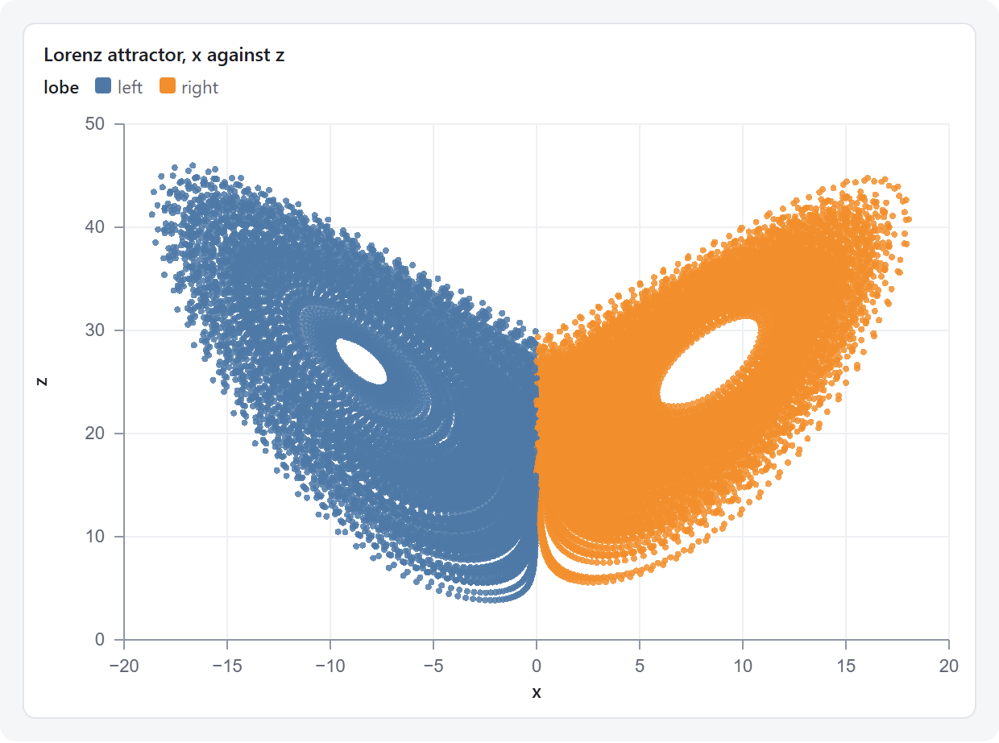

Points are drawn with WebGL, so a scatter stays smooth at hundreds of thousands of
points. Beyond 200,000 rows two numbers become a density instead, unless the chart is
coloured by a column; ask for `"type": "scatter"` to keep the points. `size` sets the
point size in pixels (default 4, or 2 above 200,000 rows).

## Histogram

One number. `bins` sets the number of bins (default 60); `color` takes one colour.

```python
sp.view({"x": "speed", "bins": 80, "color": "teal", "title": "Speed"}, data=lorenz)
```

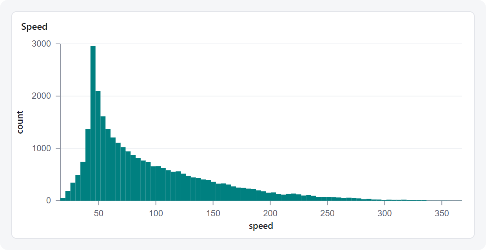

A histogram keeps its own shape while you brush it: it shows the rows that pass the
*other* charts' brushes, so you see where your range sits in the whole.

## Bars

One category. Click a bar to keep it, click others to add them, click again to drop it.
`domains` fixes the order of the bars, and categories with no rows keep their place.

```python
sp.view({
    "domains": {"way": ["stated", "supplied", "in-place", "tool", "rule", "node", "asked", "held"]},
    "x": "way", "title": "Rows by way, in a declared order",
}, data=bundle)
```

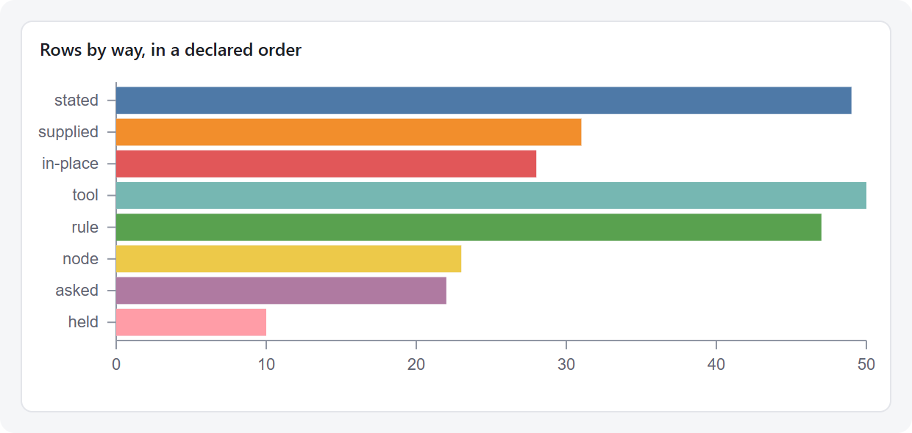

Without a domain, bars are in order of first appearance in the data. Labels longer than
about 20 characters are cut short.

## Split bars

A category, with a second category as `color`: each bar is split into it. Clicking a bar
selects it with all its segments; to brush by the second category, give it bars of its
own, or a [matrix](#matrix), which selects single pairs.

```python
OUTCOMES = {"published": "#1baf7a", "empty": "#c3c2b7", "open": "#6250d6", "missing": "#eda100",
            "blocked": "#e15759", "defect": "#e87ba4", "not-asked": "#9aa0ae"}
BUNDLE = {   # shared by the bundle's charts on the rest of this page
    "domains": {"way": ["stated", "supplied", "in-place", "tool", "rule", "node", "asked", "held"],
                "outcome": list(OUTCOMES)},
    "palettes": {"outcome": OUTCOMES},
    "key": "row",
}
sp.view({**BUNDLE, "x": "way", "color": "outcome", "title": "Each way split into outcomes"}, data=bundle)
```

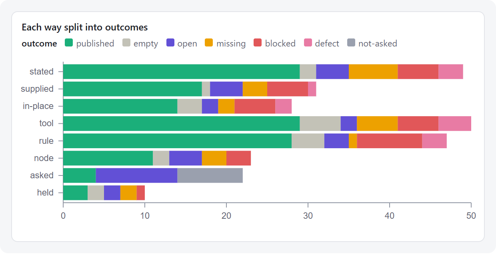

## Density

Two numbers, counted on a grid and shaded by count. It draws a million rows as fast as a
thousand, and is chosen for you above 200,000 rows. `bins` sets the grid (default
`[128, 128]`).

```python
sp.view({"x": "x", "y": "z", "type": "density", "title": "Density of states"}, data=lorenz)
```

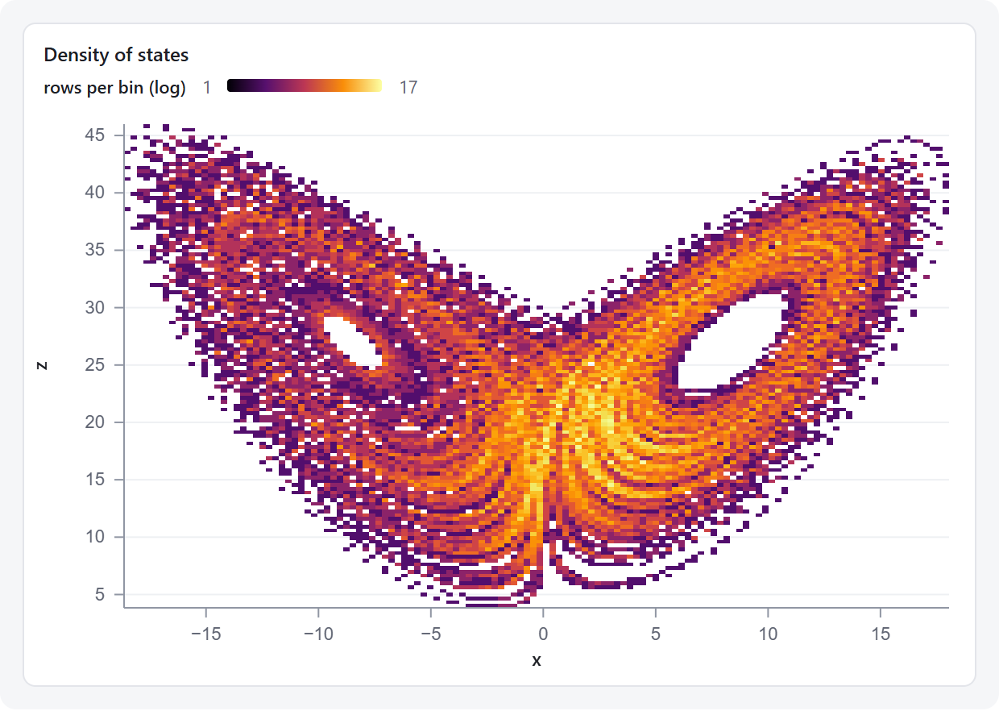

A density does not brush; it redraws from the other charts' selections.

## 3D scatter

Three numbers. Drag to turn it, scroll to zoom. `color` by a number gives a continuous
scale.

```python
sp.view({"x": "x", "y": "y", "z": "z", "color": "speed", "title": "Phase space"}, data=lorenz)
```

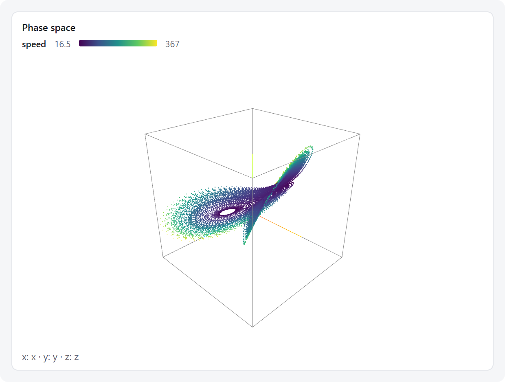

It does not brush; rows the other charts filter out are dimmed.

## Strip

A number and a category: one row of points per category, spread a little so they do not
hide each other. Drag across to select a range of the number.

```python
sp.view({**BUNDLE, "x": "outcome", "y": "margin", "title": "Margins by outcome"}, data=bundle)
```

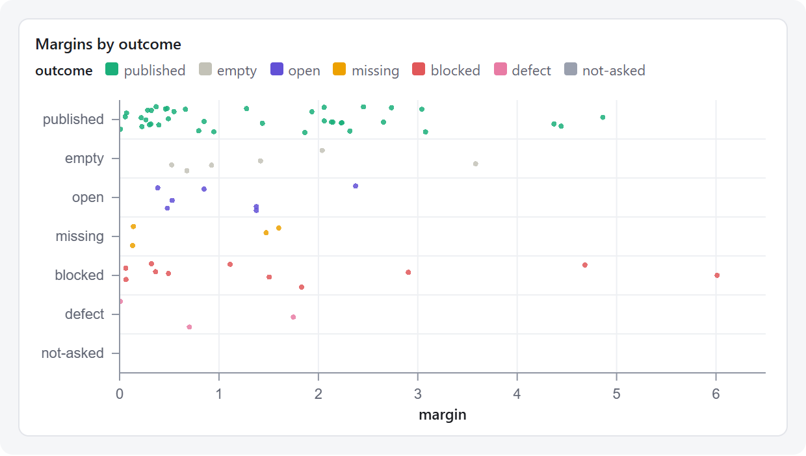

The number always runs across, whichever of `x` and `y` you give it to.

## Matrix

Two categories: a cell for each pair, shaded by its rows. Click a cell to select the
pair; click a row or column label to select the whole row or column.

```python
sp.view({**BUNDLE, "x": "label", "y": "blocker", "title": "Refusals: label by blocker"}, data=bundle)
```

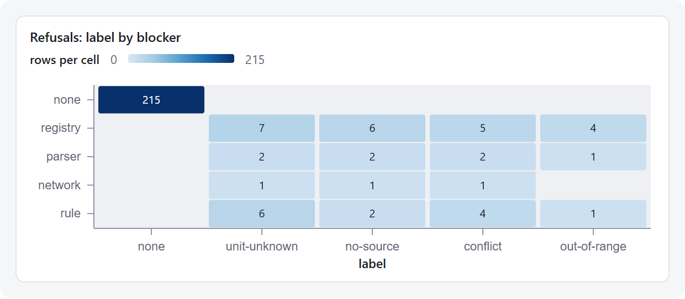

## Interval

Each row is a line from its `low` to its `high` value, banded by a category in `y`.
Drag across to select rows that *overlap* the range.

```python
sp.view({**BUNDLE, "low": "low", "high": "high", "y": "slot", "color": "outcome",
         "scale": "each", "title": "Quantities from low end to high end"}, data=bundle)
```

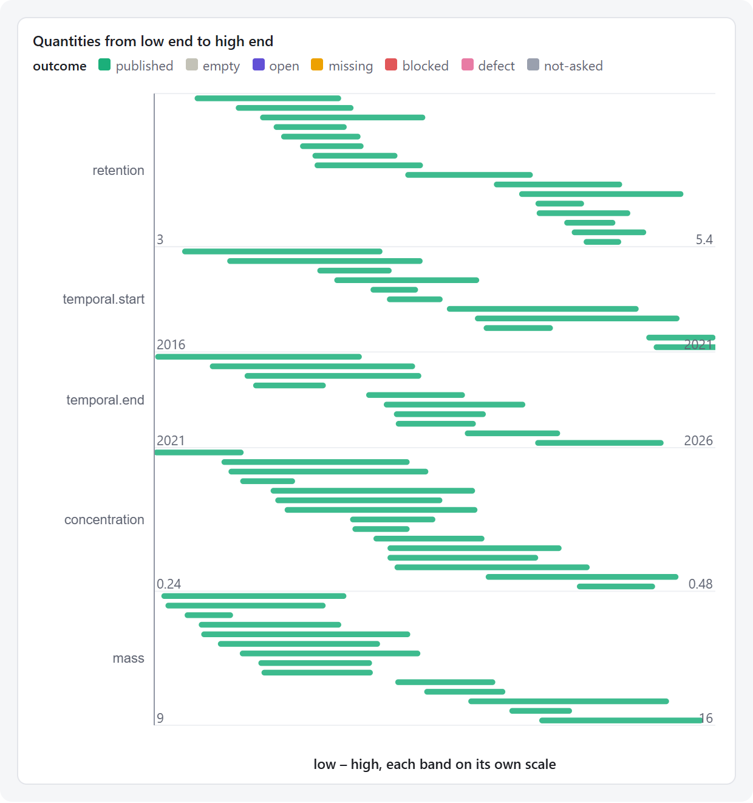

`"scale": "each"` gives every band its own scale, for quantities in different units
(years, kilograms, ratios); the default is one shared scale. A range means nothing
across different units, so an interval with a scale per band does not brush; it still
shows the other charts' selections.

## Edge charts

The last four charts read a table of **edges**: each row links a node in the `from`
column to a node in the `to` column. Rows with the same pair are drawn as one link, as
thick as its count. Clicking a node selects every link that touches it.

```python
lineage.head(3)
```

| row | slot | from_step | step |
|---|---|---|---|
| r001 | title | parse | resolve |
| r001 | title | resolve | measure |
| r002 | publisher | parse | resolve |

### Sankey

Flows from the nodes on the left to the nodes on the right. Inferred from `from` and `to`.

```python
sp.view({**BUNDLE, "from": "way", "to": "outcome", "title": "Way to outcome"}, data=bundle)
```

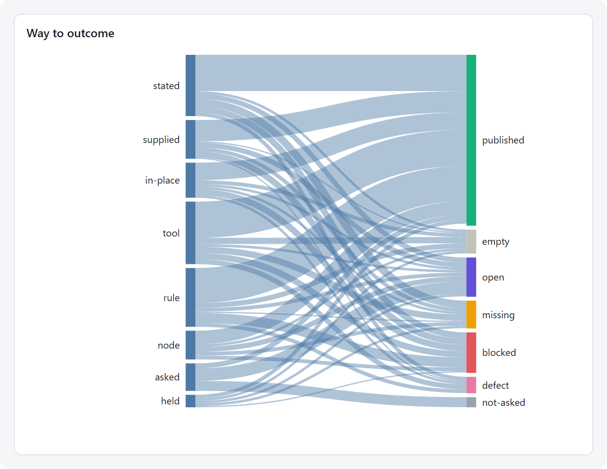

### Layers

A directed graph in layers, left to right. Each node sits one layer after the furthest
node that leads to it, so a pipeline reads in order of its steps. A link that goes back
(a cycle) is drawn dashed below.

```python
sp.view({"domains": {"step": ["parse", "resolve", "measure", "decide", "publish"]},
         "from": "from_step", "to": "step", "type": "layers",
         "title": "Rows passing from step to step"}, data=lineage)
```

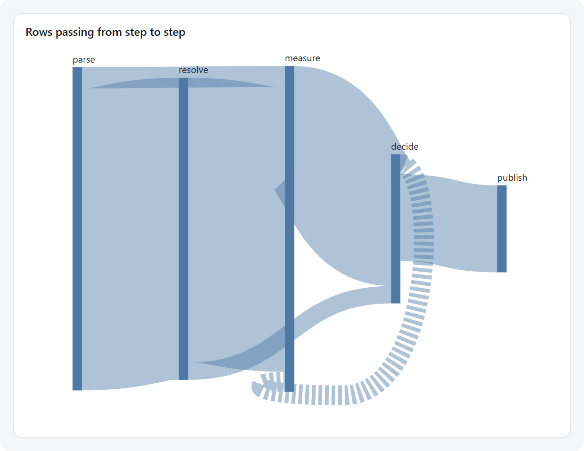

### Arc

Nodes on a line, links as arcs above it. `order` sorts the nodes: `"count"` (the most
linked first, the default), `"name"` or `"data"` (first seen).

```python
sp.view({"from": "from_step", "to": "step", "type": "arc", "title": "Steps on a line"}, data=lineage)
```

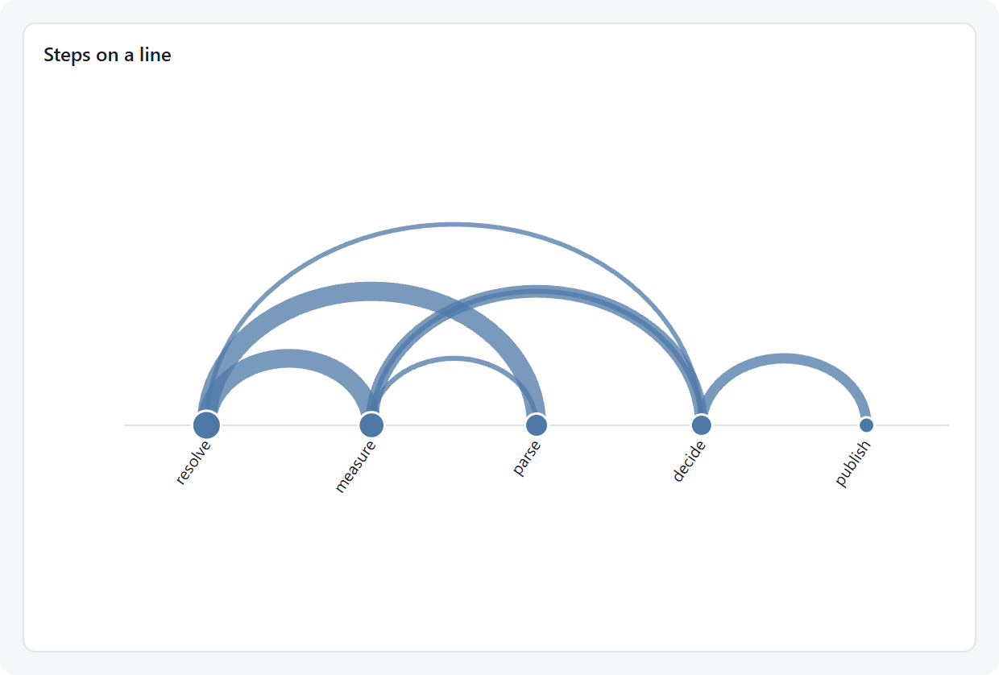

### 3D network

Nodes laid out in three dimensions by a force simulation, which starts from fixed
positions, so the same data always gives the same layout. Drag to turn, scroll to zoom,
click a node to select its links.

```python
sp.view({"from": "from_step", "to": "step", "type": "network", "title": "Steps in 3D"}, data=lineage)
```

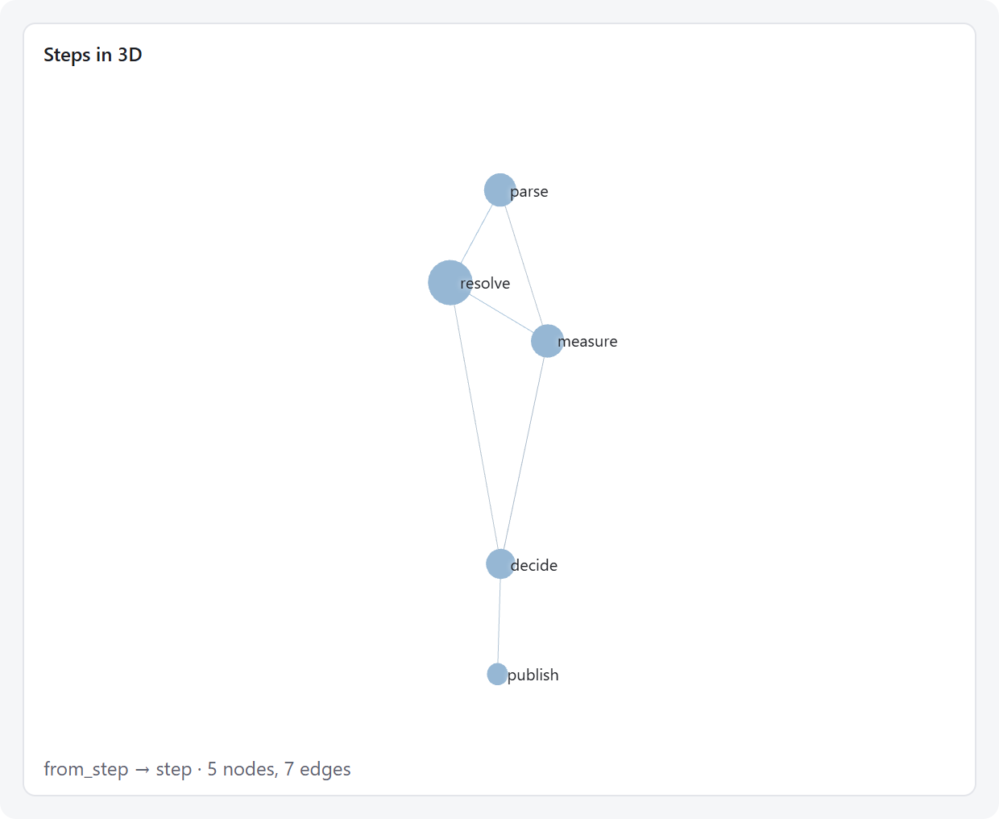

## Many charts at once

Every chart in a description reads the same table, so a strip, a matrix and a sankey of
the bundle all filter each other. A chart cannot draw two tables. Draw the edges and the
rows in two views, or give the edge table the columns you want to brush by.

```python
sp.view({**BUNDLE, "columns": 3, "charts": [
    {"x": "way", "color": "outcome", "wide": True},
    {"from": "way", "to": "outcome"},
    {"x": "outcome", "y": "margin"},
    {"x": "label", "y": "blocker"},
]}, data=bundle)
```
