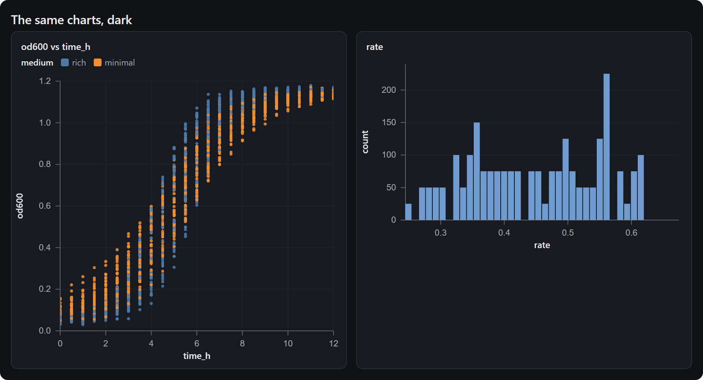

# Colours, orders and themes

```python
import spectacular as sp

df = sp.datasets.plate()
bundle = sp.datasets.bundle()
```

## `color` on a chart

`color` (or `colour`, `hue`, `fill`) takes one of three things:

| Value | Example | Effect |
|---|---|---|
| a column | `"color": "medium"` | each mark coloured by its row's value; a key appears above the plot |
| one colour | `"color": "teal"` | every mark in that colour |
| a list of colours | `"color": ["#4e79a7", "#f28e2b"]` | the colours of the categories, in order |

A string is a column when the table has a column by that name, and a colour otherwise.
A colour is `#rgb`, `#rrggbb` or a CSS colour name (`steelblue`, `tomato`,
`rebeccapurple`, …) in any letter case.

```python
sp.view({"charts": [
    {"x": "time_h", "y": "od600", "color": "medium"},           # by a column
    {"x": "rate", "color": "slateblue"},                         # one colour
    {"x": "medium", "color": ["#4e79a7", "#f28e2b"]},            # a colour per bar
]}, data=df)
```

What each chart takes:

| Chart | by a category | by a number | one colour | a list |
|---|---|---|---|---|
| scatter, strip, 3D scatter, interval | yes | yes, a continuous scale | yes | yes |
| bars | yes: [split bars](chart-types.md#split-bars) | no | yes | yes, a colour per bar |
| histogram | no | no | yes | one colour only |
| density, matrix, edge charts | no | no | no | no |

Colouring by a number uses a continuous scale from dark purple to yellow (viridis),
with the range shown in the key.

## A column's own colours: `palettes`

A category should look the same in every chart: `rich` blue in the scatter, blue in the
bars and blue in the strip. `palettes` gives a column its colours once, for the whole
description:

```python
sp.view({
    "palettes": {"medium": {"rich": "#4e79a7", "minimal": "#f28e2b"}},
    "charts": [
        {"x": "time_h", "y": "od600", "color": "medium"},
        {"x": "medium"},
        {"x": "rate", "y": "medium"},
    ],
}, data=df)
```

A palette is a mapping from category to colour, or a list of colours taken in the
category order. It holds at most 32 colours. A chart's own list of colours (at most 10)
takes precedence over the column's palette; with neither, colours come from the Tableau
10 palette, in order. A list given as `color` together with a category column becomes
that column's palette, unless `palettes` already names one, so you usually only write it
once anyway.

## The order of categories: `domains`

Categories appear in order of first appearance in the data, which is rarely the order
you mean. `domains` fixes it:

```python
sp.view({
    "domains": {"outcome": ["published", "empty", "open", "missing", "blocked", "defect", "not-asked"]},
    "x": "outcome",
}, data=bundle)
```

- Every chart of the column follows it: bars, legends, strips, matrix rows, the nodes of
  a sankey.
- A category in the domain with no rows keeps its place, as an empty bar. Missing
  categories read as "none here", not "never possible".
- Categories the domain does not name follow it, in order of first appearance.
- The palette's list form follows the domain: the first colour goes to the first
  category of the domain.

Naming a column in `domains` or `palettes` makes it a category, even if its values are
numbers.

## Themes

`theme` sets the background, text and grid colours of all the charts:

| Theme | For |
|---|---|
| `"auto"` (default) | follows the notebook or page: light or dark |
| `"light"` | a light page |
| `"dark"` | a dark page |
| `"paper"` | print: white, no panel borders, darker axes |

```python
sp.view({"theme": "dark", "columns": 2, "charts": [
    {"x": "time_h", "y": "od600", "color": "medium"}, {"x": "rate", "bins": 40},
]}, data=df)
```



Use `"paper"` for figures going into a manuscript; `render` and `save_svg` keep the theme
of the description.

## Labels

Axis and legend titles default to the column names. `labels` renames them everywhere:

```python
sp.view({"labels": {"od600": "OD600", "time_h": "time (h)"},
         "x": "time_h", "y": "od600"}, data=df)
```

Chart titles default to the columns too (`"OD600 vs time (h)"`); give a chart a `title`
to replace it.
