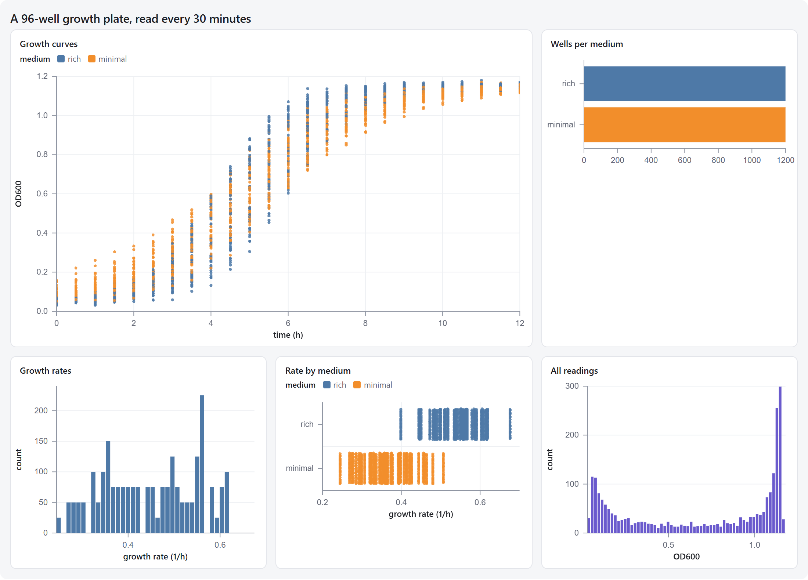
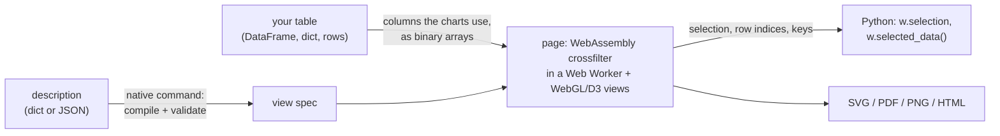

---
hide:
  - navigation
---

# spectacular-charts

**Linked, crossfiltered charts for Python and Jupyter, described in JSON instead of
written as plotting code.**

Describe the charts you want, and the chart types follow from the columns. Then brush a
range in any chart and every other chart filters to the rows inside it. The filtering
runs in the browser, in a crossfilter written in Rust and compiled to WebAssembly, so it
stays interactive on large tables. Python can read back what you selected.



```python
import spectacular as sp

df = sp.datasets.plate()     # 2,400 readings of a 96-well plate

sp.view({
    "title": "A 96-well growth plate",
    "charts": [
        {"x": "time_h", "y": "od600", "color": "medium"},   # two numbers: a scatter
        {"x": "medium"},                                    # a category: bars
        {"x": "rate", "bins": 40},                          # a number: a histogram
        {"x": "medium", "y": "rate"},                       # a category and a number: a strip
    ],
}, data=df)
```

```bash
pip install "spectacular-charts[notebook]"
```

<div class="grid cards" markdown>

-   :material-code-json: **No plotting code**

    ---

    A description is a dict or a JSON object. `"x-axis"`, `"X axis"` and `"x_axis"` are one
    key; `od600` matches the column `OD600`. A typo comes back as
    `no column "od60"; did you mean "od600"?`.

    [:octicons-arrow-right-24: Describing charts](guide/describing.md)

-   :material-link-variant: **Every chart filters the others**

    ---

    Drag across a histogram, click a bar or a matrix cell, and every chart redraws from
    the rows that pass. `w.selected_data()` returns those rows of your DataFrame.

    [:octicons-arrow-right-24: Brushing and selections](guide/selections.md)

-   :material-chart-box-multiple: **Twelve chart types**

    ---

    Scatter, histogram, bars (also split), density, 3D scatter, strip, matrix and
    interval charts. The arc, sankey, layers and 3D network charts take tables of edges.

    [:octicons-arrow-right-24: Chart types](guide/chart-types.md)

-   :material-file-image: **Figures and offline pages**

    ---

    `sp.render(..., "fig.pdf")` draws a figure at print size; `sp.save_html` writes one
    page that works with no server and no internet; `w.save_svg` saves what you see.

    [:octicons-arrow-right-24: Figures and pages](guide/figures.md)

-   :material-robot-outline: **Made to be written by programs**

    ---

    A description is plain data, so a script, a pipeline or a language model can write
    one. Problems come back as `{"path", "message"}` pairs at the exact key.

    [:octicons-arrow-right-24: For AI agents](for-ai.md)

-   :material-console: **A native command in the wheel**

    ---

    The wheel carries a compiled `spectacular` command, which turns descriptions into
    specs, validates them and writes pages, from any language, with no Node.

    [:octicons-arrow-right-24: Command line](guide/command-line.md)

</div>

## How it fits together



1. **The description** is compiled into a *view spec* by the `spectacular` command shipped
   in the wheel. The command works out each chart's type, matches column names and checks
   everything against your table's columns.
2. **Only the columns the charts use** are sent to the page, as binary arrays: numbers as
   64-bit floats, categories as codes with their labels.
3. **In the page**, a crossfilter compiled from Rust runs in a Web Worker. Each brush
   updates only the rows that entered or left its range. The views redraw from the
   selected rows, drawing points with WebGL and axes with D3.
4. **The selection** travels back to Python: the filters in data terms, the selected
   row indices and, if the description names a `key`, the key values of those rows.

## Where to go next

- New here: [Install](install.md), then the [Quickstart](quickstart.md).
- Looking for a chart: the [chart types](guide/chart-types.md) page has a picture of each.
- Writing descriptions from a program or a model: [For AI agents](for-ai.md), and
  [`llms.txt`](llms.txt) for a link to every page.
- Every key the language accepts: [Description keys](reference/keys.md).
