# spectacular-charts

[](https://pypi.org/project/spectacular-charts/)
[](https://pypi.org/project/spectacular-charts/)
[](https://fullscreen-triangle.github.io/spectacular/)
[](https://github.com/fullscreen-triangle/spectacular)

**Linked, crossfiltered charts for Python and Jupyter, described in JSON instead of
written as plotting code.**

Describe the charts you want, and the chart types follow from the columns. Then brush a
range in any chart and every other chart filters to the rows inside it. The filtering
runs in the browser, in a crossfilter written in Rust and compiled to WebAssembly, so it
stays interactive on large tables. Python reads back what you selected.

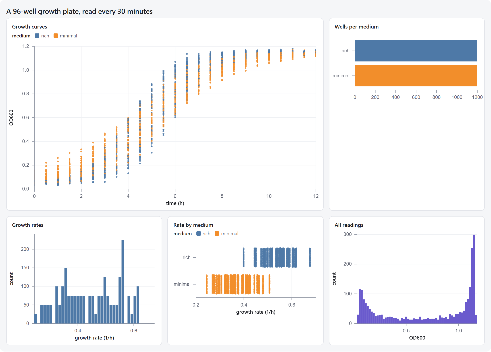

```bash
pip install "spectacular-charts[notebook]"
```

```python
import spectacular as sp

df = sp.datasets.plate()          # 2,400 readings of a 96-well plate

w = sp.view({
    "title": "A 96-well growth plate",
    "labels": {"od600": "OD600", "time_h": "time (h)"},
    "charts": [
        {"x": "time_h", "y": "od600", "color": "medium"},   # two numbers: a scatter
        {"x": "medium"},                                    # a category: bars
        {"x": "rate", "bins": 40},                          # a number: a histogram
        {"x": "medium", "y": "rate"},                       # a category and a number: a strip
    ],
}, data=df)
w
```

Brush the histogram, click a bar, and then, in the next cell:

```python
w.selection          # {"selected": 380, "rows": 2400, "filters": [{"view": ..., "field": "rate", "range": [0.52, 0.61]}, ...]}
w.selected_data()    # the brushed rows of df
```

Or skip Python altogether: after `import spectacular`, a cell can hold only the
description.

```
%%spectacular df
{"charts": [{"x-axis": "time_h", "y-axis": "od600", "color": "medium"}, {"x": "rate"}]}
```

## Why describe charts?

- **No plotting code.** A description is plain data. `"x-axis"`, `"X axis"` and
  `"x_axis"` are one key, and `od600` finds the column `OD600`.
- **Mistakes come back at the key you wrote**, with a suggestion:
  `/charts/0/y: no column "od60"; did you mean "od600"?`.
- **Programs and models can write it.** The JSON is easy to generate and check, and
  `sp.validate` returns problems as `{"path", "message"}`.
- **Linked by default.** Every chart in a description filters every other one.

## Twelve chart types

| | | |
|:-:|:-:|:-:|
| 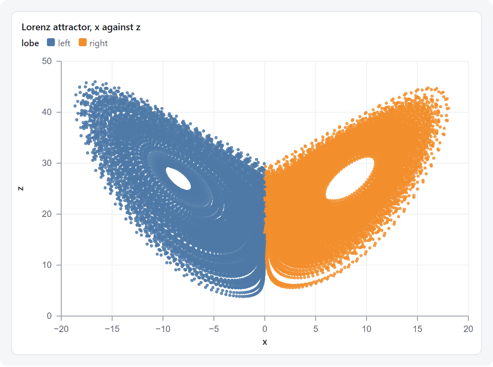 **scatter**: two numbers | 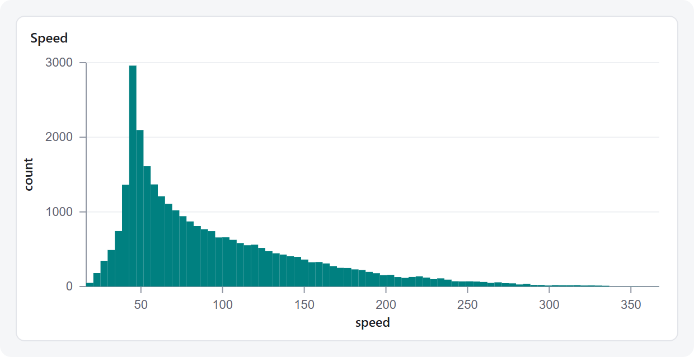 **histogram**: one number | 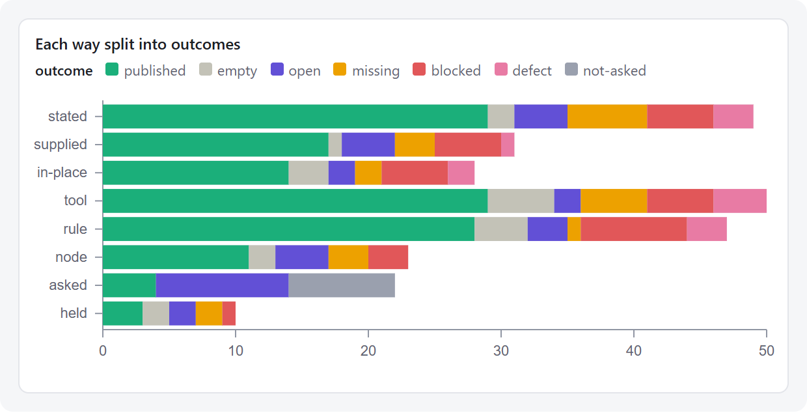 **bars**: a category, split by another |
| 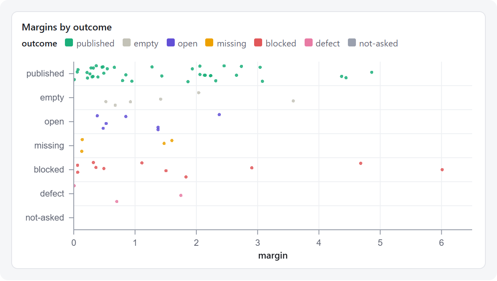 **strip**: a number by a category | 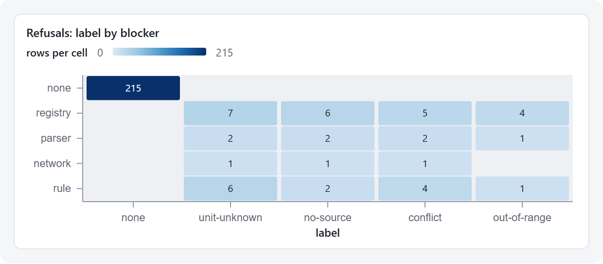 **matrix**: two categories | 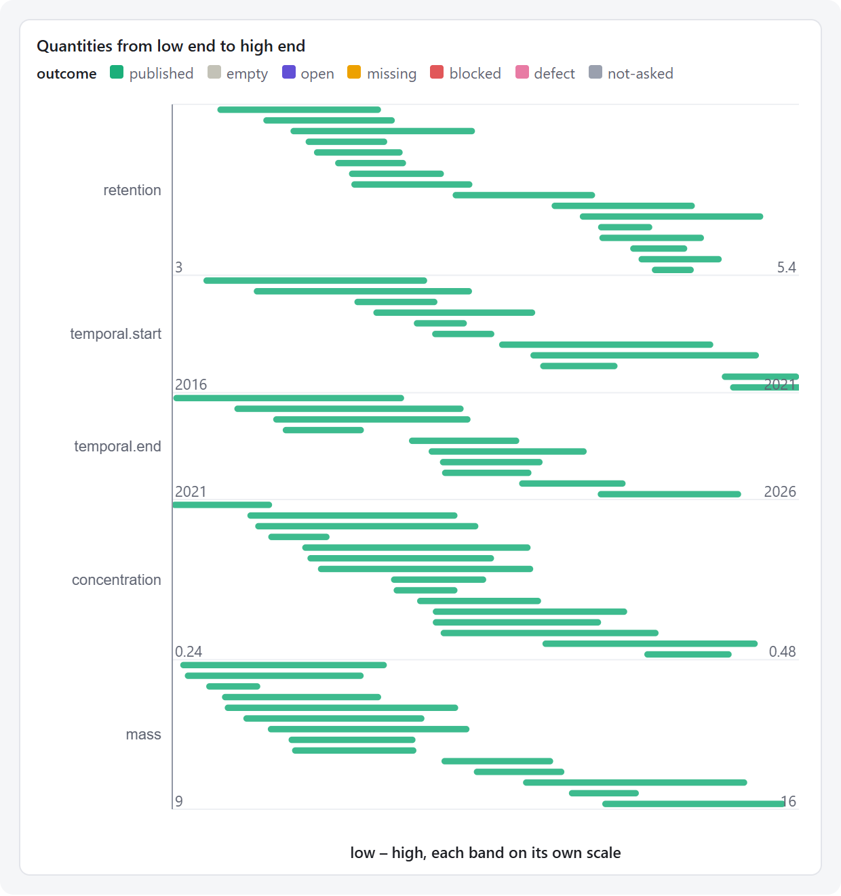 **interval**: low to high |
| 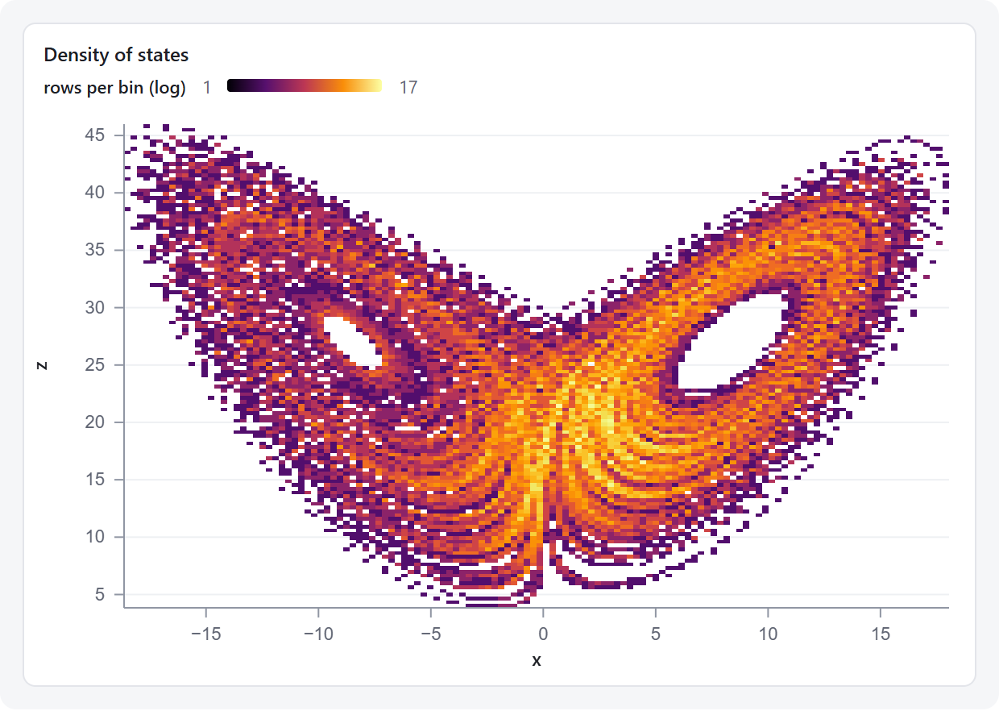 **density**: two numbers, millions of rows | 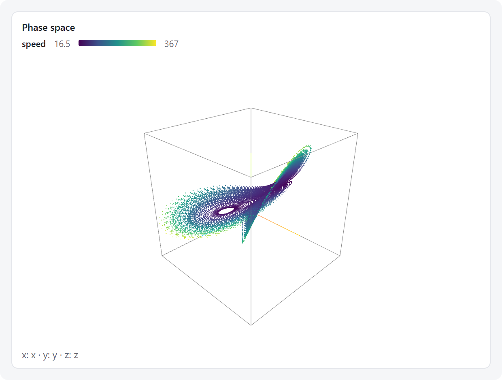 **scatter3d**: three numbers | 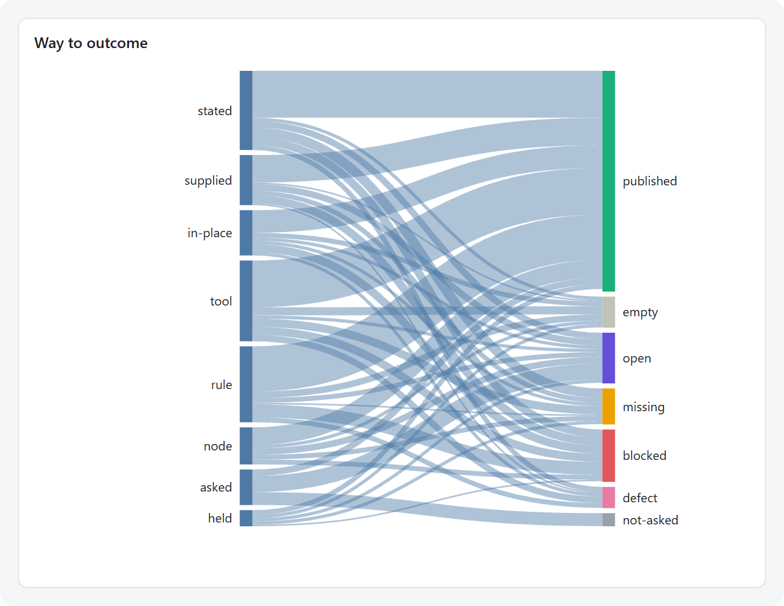 **sankey**: edges from → to |
| 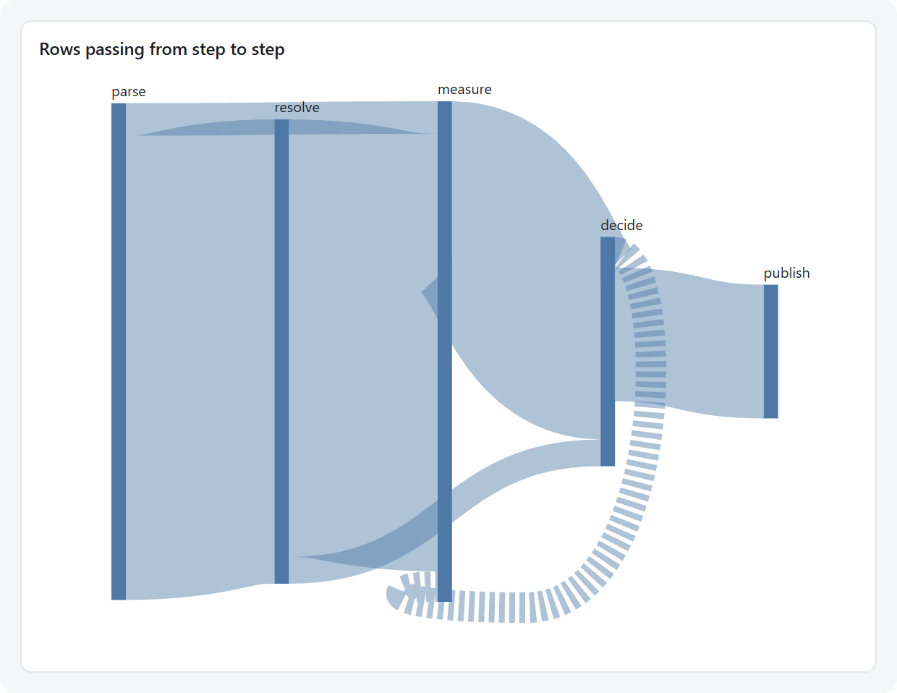 **layers**: a pipeline of steps | 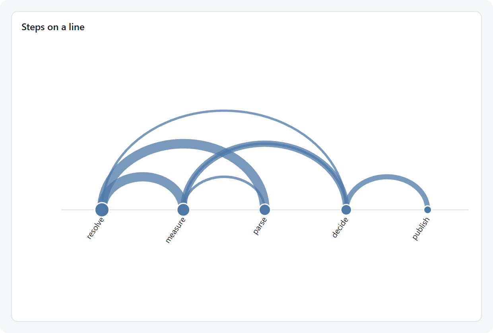 **arc**: nodes on a line | 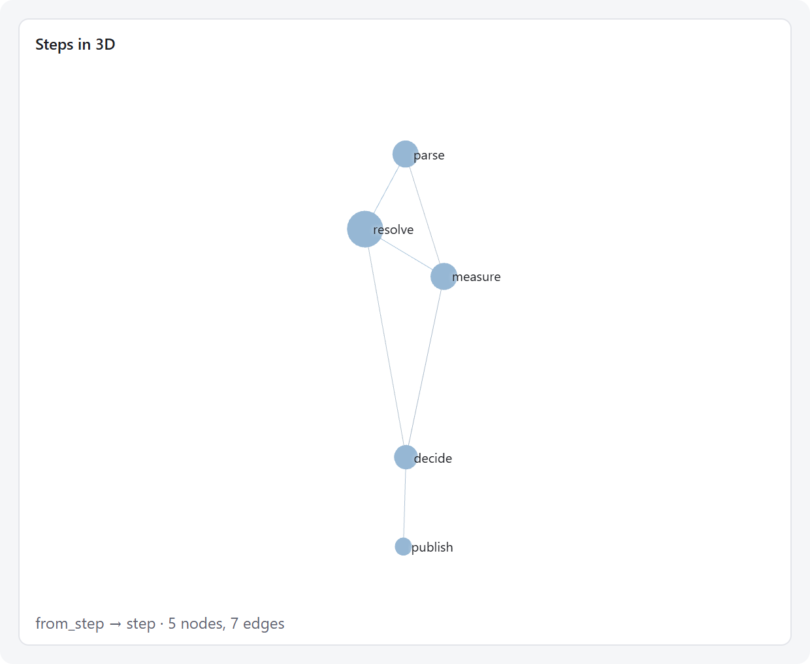 **network3d**: a graph in 3D |

How the type is chosen, and a description for each picture:
[Chart types](https://fullscreen-triangle.github.io/spectacular/guide/chart-types/).

## Figures and pages

```python
sp.render(description, "figure.pdf", data=df, width=85, unit="mm")   # SVG, PDF or PNG at print size
sp.save_html(description, "plate.html", data=df)                     # one offline, interactive file
w.save_svg("brushed.svg")                                            # what the charts show now
```

Themes: `"light"`, `"dark"`, `"paper"` (for print) and `"auto"`. Colours: a column, one
colour, a list, or a column's own palette shared by every chart. Category order:
`domains`.

## Install

```bash
pip install spectacular-charts                        # descriptions, validation, offline pages, the CLI
pip install "spectacular-charts[notebook]"            # + interactive charts in Jupyter (anywidget)
pip install "spectacular-charts[render]"              # + figures; then: python -m playwright install chromium
```

The import name is `spectacular`. Wheels for Linux, macOS and Windows carry the browser
runtime and a native `spectacular` command (compiled Rust) that compiles descriptions,
validates specs and writes pages without Node:

```bash
spectacular compile chart.json --data readings.csv   # the view spec a description makes
spectacular validate spec.json --json                # problems by path; exit 1 if any
spectacular html chart.json --data readings.csv -o readings.html
```

## Documentation

- **[Documentation](https://fullscreen-triangle.github.io/spectacular/)**: quickstart, guide, reference
- [Describing charts](https://fullscreen-triangle.github.io/spectacular/guide/describing/) and [every key](https://fullscreen-triangle.github.io/spectacular/reference/keys/)
- [Brushing and selections](https://fullscreen-triangle.github.io/spectacular/guide/selections/)
- [Python API](https://fullscreen-triangle.github.io/spectacular/reference/python/)
- [For AI agents](https://fullscreen-triangle.github.io/spectacular/for-ai/): the description language on one page
- [Changelog](https://github.com/fullscreen-triangle/spectacular/blob/rebuild/python/CHANGELOG.md)

Source, issues and the full view-spec format:
[github.com/fullscreen-triangle/spectacular](https://github.com/fullscreen-triangle/spectacular)
(branch `rebuild`). MIT licence.
